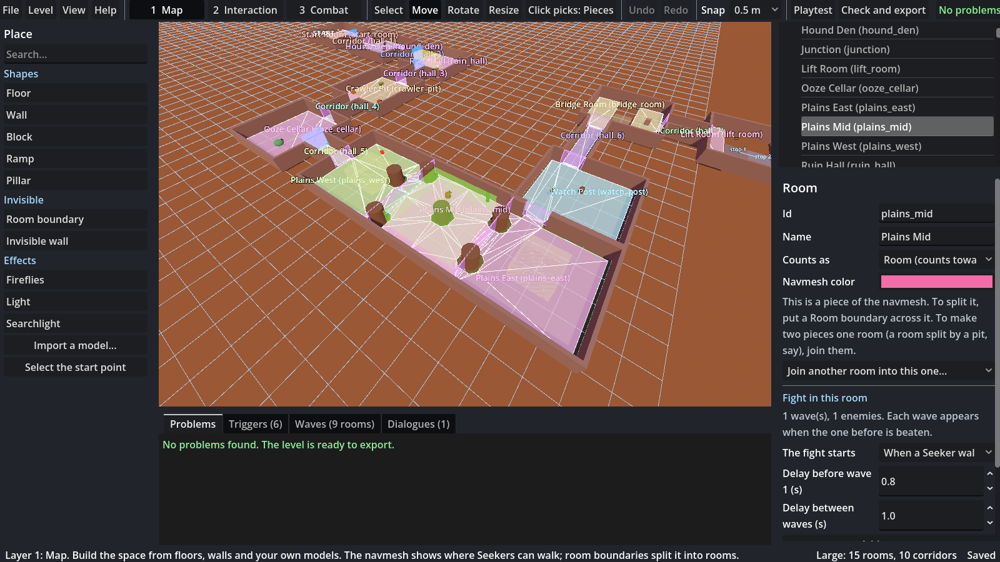
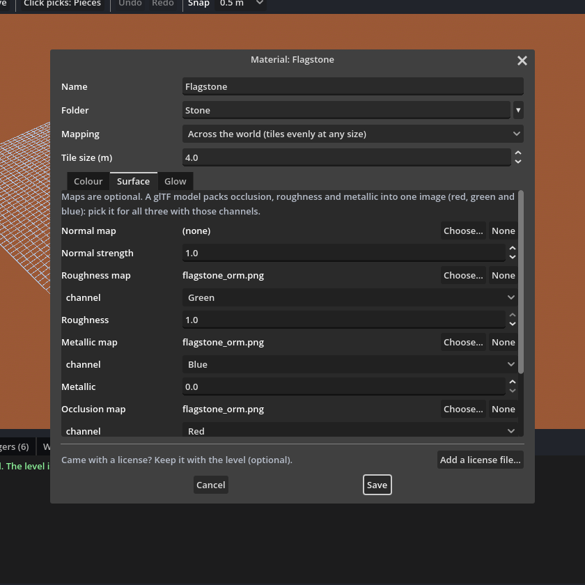
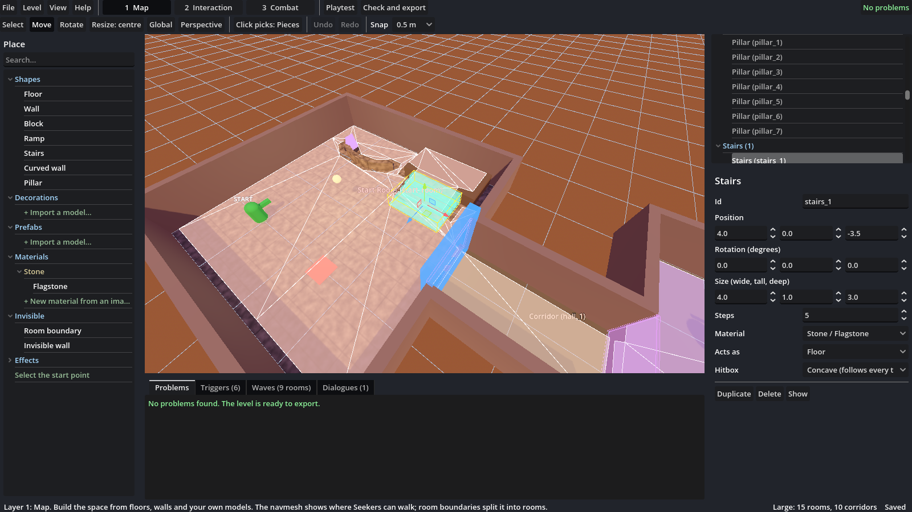
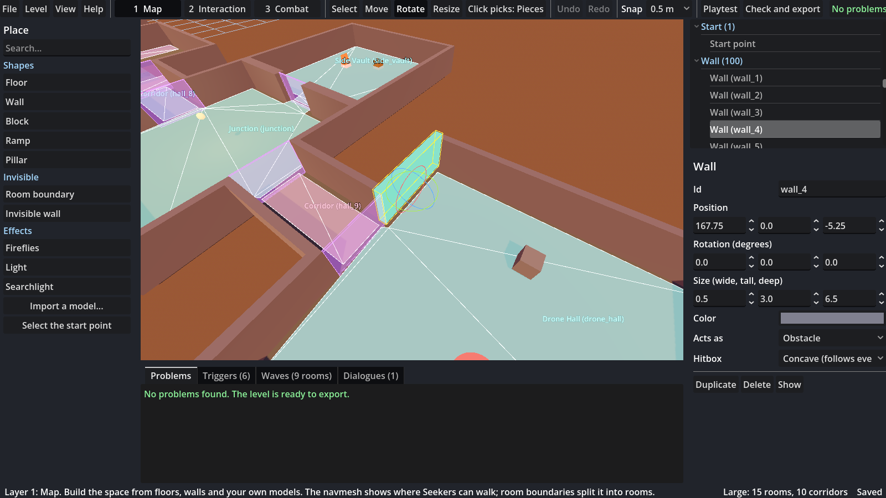
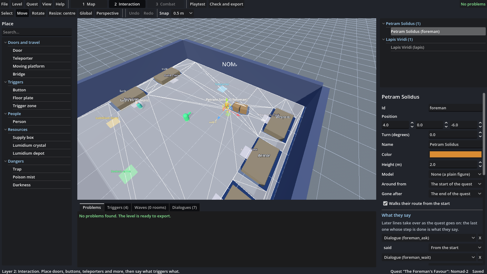
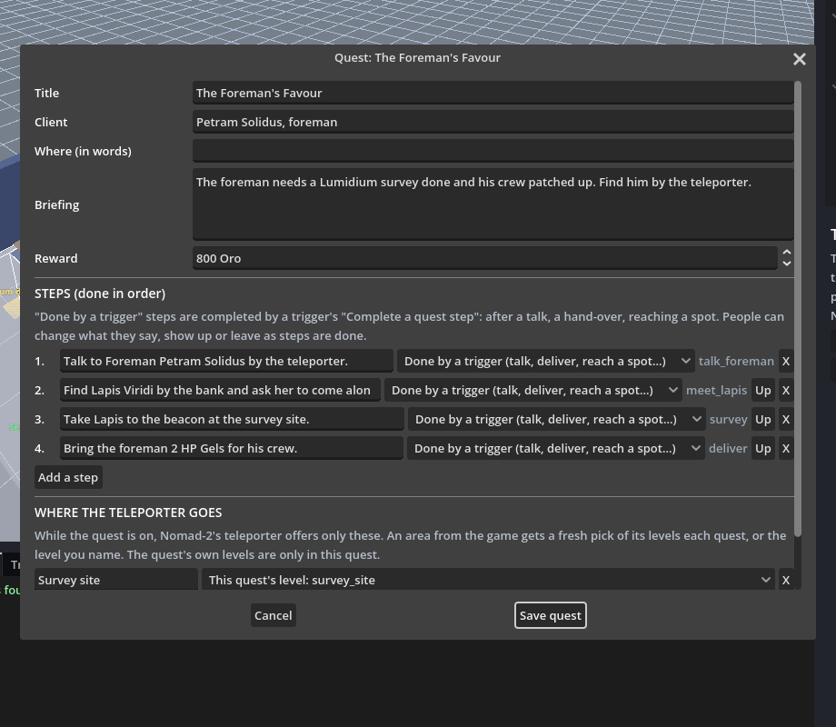

# Nomad's Seekers Level Editor

A standalone Godot 4 app for building levels for *Nomad's Seekers*. Levels are plain data (JSON plus
`.glb`/`.gltf` models), so they can be shared and, later, put on the Steam Workshop.

You build a level like Lego: place floors, walls and your own models wherever you like. A
**navmesh** shows where Seekers can walk and updates as you build. **Room boundaries** split it into
rooms, and each room gets its own color.



## Starter example

**Help > Open the starter example** (or the button on the welcome screen) opens your own copy of
*Mossy Ruins*. It's a 15-room Large level built only from basic shapes, room boundaries and the
navmesh:
- fights, and a dialogue that starts a fight
- doors that open when a room is cleared
- open plains split into three rooms by boundaries and broken up by rocks
- a poison mist with a vent button
- a bridge over a pit and a lift over another (each room's two sides joined into one)
- a boss room that wakes the exit
- a dais up a flight of stairs, a curved planter wall and a flagstone material

The original is in `examples/starter_large/`. `tools/build_starter_level.gd` rebuilds it
deliberately out of order: enemies before floors, boundaries before anything to cut, floors dumped
on a pile then slid into place, walls last, and one wall dropped across a doorway by mistake. Then
it makes the level compliant. Its `BUILD_LOG.md` lists each step.

## Building a level

1. **New level**: a name, an area (forest_1, ...) and lighting. There's no size to pick. It
   follows from how many rooms you end up with: an Arena is 1 room; Small 5–9, Medium 10–14,
   Large 15–19, Huge 20–25. Corridors don't count.
2. **Layer 1, Map.** Place the pieces:
   - **Shapes**: Floor, Wall, Block, Ramp, **Stairs**, **Curved wall**, Pillar.
     - Stairs have a **Steps** count. Each step is height ÷ steps tall, and a Seeker can only climb
       about 0.4 m, so if the navmesh doesn't continue up the flight, add steps (or make it lower
       or longer) until it does.
     - A curved wall has a **Bend** in degrees (0 is straight, 360 a full ring; negative bends the
       other way). Its width is its length along the curve.
   - **Decorations** and **Prefabs**: your own models. Use "+ Import a model..." in either (or
     Level > Import a model) and pick which one it goes in. They're the same to the game; the split
     is just to keep small dressing apart from bigger ready-made pieces.
   - **Materials**: paint a shape or a model. Make one from an image ("+ New material from an
     image..." or Level > New material), or tick "Also add its materials" when importing a model
     to bring its textures along. Pick a material in the list, then click pieces to paint them
     (click again to take it off), or set **Material** in the inspector. Materials are mapped
     onto the world, so tiling stays even however you stretch a shape; **Tile** sets how many
     metres one copy of the image covers. (A model's own materials keep the model's UVs instead.)

     The material window has three tabs:
     - **Colour**: colour image and tint, and transparency: **Cut-out** for leaves and fences,
       **See-through** for glass and water. It's only visual; solid pieces still block the way.
     - **Surface**: normal map, roughness, metallic and occlusion maps, each reading a channel
       (a glTF packed image is occlusion red, roughness green, metallic blue), and a height map
       (needs Mapping: the model's own UVs).
     - **Glow**: a glow color, brightness and glow map.

     Importing a model with "Also add its materials" brings all of these across.

     
   - **Invisible**: Room boundary and Invisible wall (both drawn as faint boxes so you can see and
     grab them).
   - **Effects**: lights, fireflies, searchlights.

   **Licenses** are optional. **Level > Licenses** is one place per level for the licenses of
   what you bring in: add files (a pack's License.txt, a LICENSE, a PDF), or write one in the
   editor. The import and material windows have an "Add a license file..." button for when
   something comes with one. They're kept in the level's `licenses/` folder and go along with it
   when you export or share it.

   **Folders.** Right-click Decorations, Prefabs or Materials (or a folder) for a new folder;
   folders nest and can be renamed or deleted (what's in a deleted folder moves up a level).
   Drag things onto a folder to move them, or right-click > Move to folder. Click the arrows to
   collapse what you aren't using; the editor remembers what's closed. Searching opens everything
   that matches.


3. **Every piece is a floor, an obstacle or intangible** ("Acts as" in the inspector):
   - **Floor**: solid; the navmesh is built on top of it.
   - **Obstacle**: solid; blocks the navmesh, and nothing walks on top of it or inside it.
   - **Intangible**: no collision; the navmesh ignores it. Only intangible things can be animated.

   Solid pieces get a **hitbox** made from their own shape: **Concave** (the default) follows
   every triangle; **Convex** wraps it in one hull (faster, but fills in arches). You choose both
   when you import a model, can change them later for every copy (Level > Imported models), or
   override them on any one placed copy. Select a piece to see its hitbox as a cyan wireframe:
   that's exactly what the game builds.
4. **Rooms come from the navmesh.** The navmesh is sized for a Seeker (0.4 m radius) and rebakes a
   moment after each change. Each separate piece of it is a room, in its own color: the first is
   blue, and a newly split-off one gets a new color.
   - **Split** a room by putting a Room boundary across the doorway or gap between the two parts.
     It has to close the opening completely, or the navmesh goes round it (the Problems tab says so).
   - **Pick** a room by turning on **Click picks: Rooms** (N) and clicking its navmesh. On Layer 3,
     clicking the navmesh always picks the room.
   - **Change** a room in the inspector: name it, make it a **corridor**, or **join** another room
     into it (for a room split by a pit).
5. **Layer 2, Interaction**: doors, teleporters, platforms, bridges, buttons, zones, hazards,
   dialogues. Say what triggers what in plain sentences.
6. **Layer 3, Combat**: enemies in waves per room, wander and chase leashes, spawn delays.
   Enemies may stand in corridors.
7. **Playtest** (F5) runs the level in the game. **Check and export** (Ctrl+E) checks it, then
   writes a folder or zip, or exports straight into the game's `levels/<area>/`.



## Quests

Quests work like PSO's: **accepting one at the Guild starts a quest session**. Nomad-2 reloads with the people and props you placed for it, and its teleporter goes only to the quest's areas until the quest is reported or abandoned. Steps are done in order. In co-op the leader's quest is the whole party's.

- **Quest > New quest** makes a quest folder (in your library's `quests` folder) and opens **its Nomad-2**: a fixed copy of Nomad-2 (floor, walls, counters, signs, teleporter, depot and where Seekers arrive) that you build on. You can't move Nomad-2 itself; you add people, props and lights, plus their dialogue and triggers. Nomad-2 is peaceful, so it has no Combat layer.
- **Quest > Quest details** holds the title, client, briefing, reward, the **steps** and **where the teleporter goes**.
  - Steps can be: *done by a trigger* (talking to someone, a hand-over, reaching a spot), *defeat a number of an enemy*, *clear every room of an area*, or *bank Lumidium*.
  - Where it goes: areas from the game (a fresh pick each time, or a level you name) and the quest's own levels.
- **Quest > New level for this quest** makes a level that only this quest uses (with a floor and a teleporter back), and adds it to where the teleporter goes. **Quest > The quest's Nomad-2 and levels** switches between them.
- **People** (Interaction layer, *People*): a name, a colour or one of your models, and a height.
  - **What they say:** one or more dialogues, each taking over once a step is done.
  - **Around from / Gone after:** steps, so they show up or leave as the quest goes on.
  - **Walk route:** a loop, or back and forth.
- **Quest triggers**, available in the quest's Nomad-2 and its levels:
  - **Sets it off:** *someone is talked to*, *a quest step is done*.
  - **Checks:** *quest step is done / current / not done yet*, *a quest flag*, *the Seeker who talked has an item*, *an escort is near*.
  - **Actions:** *complete a quest step*, *set a quest flag* (it lasts the whole quest), *take an item* (deliveries), *give an item*, *bring someone in / send them away*, *have them walk*, *change what they say*, *have them follow the party (escort)*, and *stop an escort*. Escorts come along to the quest's levels, so a level's triggers can check that they're near.
- **Quest > Check and export the quest** checks the quest and every part of it, then writes the whole folder into the game's `quests` folder, where the Guild lists it. **Quest > Playtest the quest** starts it on Nomad-2 in the game.





The game's `quests/foremans_favour` is a worked example. Open it with Quest > Open a quest.

`catalog/nomad2_base.json` is the copy of Nomad-2. After changing the hub in the game, write a new one with the game's `tools/export_nomad2.gd -- <path>`.

## Moving things (like Godot)

| Key | What it does |
|---|---|
| Q | Select only |
| W | Move: arrows along each axis, and squares that slide it across the XY, XZ or YZ plane |
| E | Rotate: rings around each axis (snaps to 15°) |
| R | Resize. Press R again to switch between the two styles (the button shows which). **From centre**: a handle per axis, and a white middle cube that resizes evenly. **By sides**: a handle on every face and corner. Pull a face and the opposite face stays put; pull a corner and the box scales toward it while the opposite corner stays put. |
| T | Global / Local: move and rotate along the world's axes or the piece's own. Resizing always uses the piece's own axes. |
| O (or Numpad 5) | Perspective / orthographic camera |
| Numpad 7 | Top-down view |

You can also click and drag a piece to slide it along the ground. Moving and resizing follow the
**Snap** setting; hold **Alt** to turn snapping off. Look around with the right mouse button, and
hold it while pressing W A S D to fly; while you're flying, W, A, S, D, Q and E only move the camera.
Help > Controls lists everything.

## Export checks

Problems are listed live in the Problems tab and again when you export. **Must fix** items block
export; **Check** items are warnings you can export past. Double-click one to jump to it.

Must fix, for example:
- the room count fits no size (2–4, or more than 25), or an Arena has a corridor
- the start point isn't on the navmesh
- an enemy stands off the navmesh (outside every room and corridor)
- an enemy with limited chase whose chase radius is smaller than its wander radius
- a closed door that nothing opens (give it a trigger, or tick "Stays locked on purpose")
- a fight in a room that no longer exists
- no exit teleporter, unknown enemies, empty waves, triggers pointing at deleted things
- models whose file is missing
- in a quest: no title, no steps or nowhere to go; triggers, people or lines naming a step the quest doesn't have; a quest action in a level that isn't part of a quest
- materials whose image is missing, and pieces painted with a material that's gone

Check, for example:
- a room Seekers can't walk to from the start (bridges and moving platforms count as joining
  their two ends)
- a boundary that doesn't split anything
- a tiny room
- no depot
- a button or zone that triggers nothing

## Level format

Format 2, described in the game repo's `docs/level_format.md`. `addons/seeker_data/level_data.gd` and
`addons/seeker_data/level_nav.gd` and `addons/seeker_data/level_materials.gd` are shared with the game and must stay identical in both repos.
The navmesh, the rooms and the hitboxes come from the same code on both sides.

## Tests

```
godot --headless --path . --script res://tests/editor_test.gd     # rooms, boundaries, sizes, surfaces, checks, saving
godot --headless --path . --script res://tests/stress_test.gd     # the whole app through odd build orders
godot --headless --path . --script res://tests/library_test.gd    # importing, folders, materials, stairs, curved walls
godot --headless --path . --script res://tests/quest_test.gd      # quests: Nomad-2, people, quest triggers, details, export (needs ../nomad-seekers)
xvfb-run godot --path . --resolution 1600x900 --script res://tests/ui_test.gd   # mouse: placing, the handles
godot --headless --path . --script res://tools/build_starter_level.gd   # rebuilds examples/starter_large
```

The stress test passes when its output has no `SCRIPT ERROR` or `ERROR:` lines.

## Exporting the editor as an app

Add `catalog/*` and `examples/*` to the export preset's "Filters to export non-resource files" so
the enemy list and the starter example ship with it.
