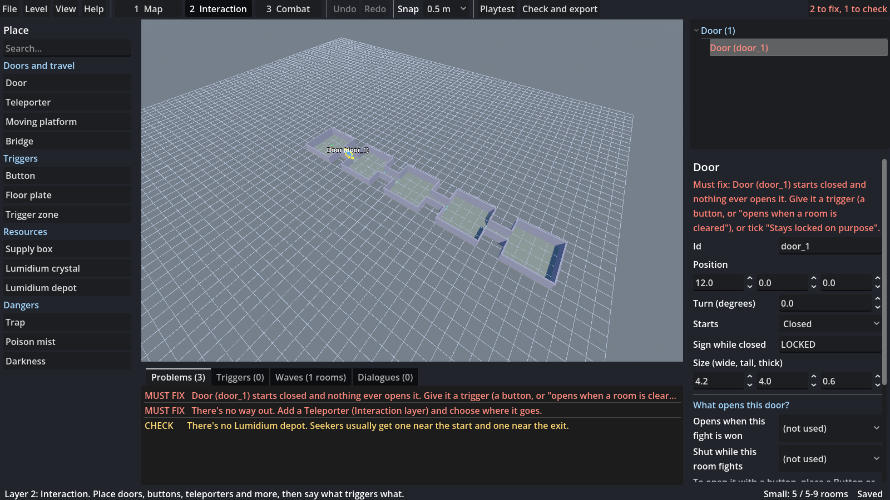

# Nomad's Seekers Level Editor

A standalone Godot 4 app for building levels for *Nomad's Seekers*. Levels are plain data (JSON plus
`.glb`/`.gltf` models), so they can be shared and, later, put on the Steam Workshop.



## Starter example

**Help > Open the starter example** (or the button on the welcome screen) opens your own copy of *Mossy Ruins*: a 15-room Large level with fights, a dialogue that starts a fight, doors that open when rooms are cleared, an open plains area, a poison mist with a vent button, a bridge, a lift and a boss room that wakes the exit. The original lives in `examples/starter_large/`. `tools/build_starter_level.gd` rebuilds it, deliberately out of order (enemies before rooms, rooms dumped on top of each other then dragged into place, corridors last), and its `BUILD_LOG.md` lists each step.

## Using it

1. Open the project in Godot 4.7 and run it (or export it as an app).
2. **New level**: pick a name, a size (Arena 1 room, Small 5-9, Medium 10-14, Large 15-19, Huge 20-25; corridors don't count) and an area (forest, ...).
3. Build in three layers. Switch any time with the buttons or the 1 / 2 / 3 keys:
   - **1 Map**: rooms, corridors, floors, walls, ramps, invisible walls, decorations, lighting (clamped to safe ranges). Walls, floors and doorways are generated for you where rooms touch. Each room's **Where it touches a room** setting decides what a shared edge becomes: a 4 m doorway (default), **fully open** (no wall at all, for a big field split up by rocks) or a **solid wall**. When two rooms disagree, solid wall beats doorway, and doorway beats fully open.
   - **2 Interaction**: doors, teleporters, moving platforms, bridges, buttons, floor plates, trigger zones, supply boxes, crystals, hazards, dialogues. Say what triggers what in plain sentences ("When the party enters this zone, open this door").
   - **3 Combat**: enemies placed in waves per room, wander and chase leashes, spawn delays. Enemies may stand in corridors.
4. **Playtest** (F5) runs the level in the game. Set the game folder in File > Settings first.
5. **Check and export** (Ctrl+E) checks the level, then writes a folder or zip, or exports into the game's `levels/<area>/` folder.

Press **Help > Controls** in the app for every shortcut.

## Export checks

Problems are listed live in the Problems tab and again when you export. **Must fix** items block export; **Check** items are warnings you can export past.

Must fix, for example:
- an enemy with limited chase turned on whose chase radius is smaller than its wander radius, or a radius of zero or less
- a closed door that nothing ever opens (give it a button, a "fight won" link, or tick "Stays locked on purpose")
- a door waiting on a room that has no fight
- a size mismatch (too few or too many rooms), no rooms, corridors in an Arena, a start point outside any room, a room that can't be reached
- no exit teleporter, a teleporter that is never woken, bridges that are never extended
- unknown enemies, enemies standing outside every room and corridor, empty waves, negative spawn delays, triggers pointing at deleted items
- models without a license note or whose file is missing

Check, for example: no Lumidium depot, buttons or zones that trigger nothing, hazards with no switch, dialogues never started.

Double-click a problem to jump to the thing that needs fixing.

## Level format

See the game repo's `docs/level_format.md`. A level is a folder: `level.json`, `map.json`, `interaction.json`, `combat.json` and `assets/`.

## Tests

```
godot --headless --path . --script res://tests/editor_test.gd     # checks, joins, export, undo, the example
godot --headless --path . --script res://tests/stress_test.gd     # drives the whole app through odd build orders
godot --headless --path . --script res://tools/build_starter_level.gd   # rebuilds examples/starter_large
```

The stress test passes when its output has no `SCRIPT ERROR` or `ERROR:` lines.

## Exporting the editor as an app

Add `catalog/*` and `examples/*` to the export preset's "Filters to export non-resource files" so the enemy list and the starter example ship with it.
